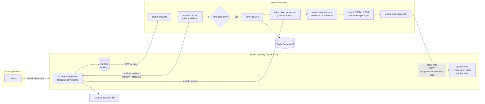

# bifrost-freshness

**A stale-answer auditor for the [Bifrost](https://github.com/maximhq/bifrost) AI gateway.**
It reads recent answers from Bifrost's logs API, finds the time-sensitive factual claims in them
(prices, versions, office holders, laws, statistics, dates), re-checks each one against live web
sources with [Tavily](https://tavily.com), and tells the gateway operator **which model is serving
outdated facts, on which topics, with the evidence** — then proposes a Bifrost routing rule that keeps
the stalest model away from time-sensitive traffic.

Built for the Geek Room Global AI Hackathon 2026 as one integrated solution for
**Challenge 04 — Build the missing open-source gateway feature** (Bifrost track) and
**Challenge 05 — Stale-answer detector** (Tavily track).

---

## The operator problem

A gateway operator can already see cost, latency, error rate and token usage per model in Bifrost.
What they cannot see is **how often a model confidently states something that is no longer true.**
Every model has a training cutoff, and an operator who routes between several models (or swaps
in a cheaper/local one) has no signal for "this model tells users that Pat Gelsinger runs Intel".

`bifrost-freshness` adds that signal, using only documented Bifrost extension points:

| Bifrost extension point | How it is used |
|---|---|
| **Logs API** `GET /api/logs`, `GET /api/logs/{id}` | Source of the answers to audit (filters: `objects`, `status`, `start_time`, `models`). The auditor's own traffic is excluded by virtual key. |
| **OpenAI-compatible inference** `POST /v1/chat/completions` | Every LLM call the auditor makes (claim extraction, claim judging) goes through Bifrost. |
| **Request-level fallbacks** (`fallbacks: [...]`) + `extra_fields.routing_info` | If the auditor's primary model fails, Bifrost falls back; the CLI/report say which model took over (`routing_info.is_fallback`). |
| **Governance: virtual key + rate limit + budget** (`x-bf-vk`) | The auditor runs under its own virtual key with a token/request cap. A `402`/`429` from governance stops the run cleanly and keeps partial results. Live usage is read from `GET /api/governance/virtual-keys/{id}`. |
| **Routing rules** (CEL) `POST /api/governance/routing-rules` | The report suggests rules in Bifrost's `governance.routing_rules` shape; `apply-rules` creates them on a running gateway. |

No Go plugin and no fork: it runs against a **stock** `npx @maximhq/bifrost` install.
(Go `.so` plugins are not supported on Windows, so the feature is built entirely on the HTTP extension points.)

## Architecture



### Pipeline per answer

1. **Collect** — list recent successful `chat_completion` logs, skip the auditor's own virtual key,
   fetch each log's detail (the list view omits `output_message`).
2. **Extract** (LLM through Bifrost, JSON mode) — atomic, self-contained claims, each with a category
   (`price, version, office_holder, law, statistic, schedule, product, other`), a time-sensitivity flag,
   a sensitivity level, and a search query that asks for the *current* value.
3. **Research** (Tavily) — only time-sensitive claims are searched (one `basic` search, 5 results each).
   Stable facts ("Intel was founded in 1968") cost nothing.
4. **Judge** (LLM through Bifrost) — `supported` / `changed` / `unverifiable`, confidence, the current
   value if changed, quotes with source numbers, and a separate one-line `inference`.
5. **Verify in code** — every quote must be found in the cited source text (exact after normalization,
   or ≥90% word overlap for "near-verbatim"). Quotes that are not in the source are dropped and noted.
   A `supported`/`changed` verdict left without any verified quote is **downgraded to `unverifiable`**.
   This is how evidence (text that exists in a source) is kept apart from inference (the model's words).
6. **Score** — freshness indicator per claim: `100` = sources confirm it is current, `0` = sources confirm
   it changed, `?` = unknown; plus a high/medium/low confidence band from confidence × number of quotes.
7. **Report** — per audited model and per topic: researched / supported / changed / unverifiable and the
   **staleness rate** = changed ÷ (supported + changed). JSON + a static HTML dashboard.
8. **Suggest** — for models whose staleness rate is ≥ 34% and above the freshest audited model, emit a
   routing rule: `provider == "ollama" && model == "<stale>" && headers["x-freshness-sensitive"] == "true"`
   → target the freshest model. Applications tag time-sensitive requests with that header.

## Setup against a stock Bifrost

Requirements: Node.js **22.18+** (TypeScript runs natively, no build step), a Tavily API key,
and any LLM provider Bifrost supports. This repo's demo uses local **Ollama** models only.

```bash
git clone <this repo> && cd bifrost-freshness
npm install            # dev-only deps (typescript, @types/node) for `npm run typecheck`; runtime has zero deps
cp .env.example .env   # then edit: admin password, virtual-key values, Tavily key (or key file path)
```

### 1. Bifrost configuration (`bifrost/config.json`)

The included config is plain Bifrost `config.json` — nothing custom. Secrets are `env.*` references:

```json
{
  "client": { "enable_logging": true, "disable_content_logging": false },
  "providers": {
    "ollama": {
      "keys": [{ "name": "ollama-local", "value": "", "models": ["*"], "weight": 1.0,
                 "ollama_key_config": { "url": "env.OLLAMA_URL" } }],
      "network_config": { "default_request_timeout_in_seconds": 600, "max_retries": 0 }
    }
  },
  "config_store": { "enabled": true, "type": "sqlite", "config": { "path": "./config.db" } },
  "logs_store":   { "enabled": true, "type": "sqlite", "config": { "path": "./logs.db" } },
  "governance": {
    "auth_config": { "is_enabled": true, "admin_username": "env.BIFROST_ADMIN_USERNAME",
                     "admin_password": "env.BIFROST_ADMIN_PASSWORD", "disable_auth_on_inference": true },
    "rate_limits": [{ "id": "rl-freshness-auditor", "token_max_limit": 400000, "token_reset_duration": "1d",
                      "request_max_limit": 400, "request_reset_duration": "1d" }],
    "budgets": [{ "id": "budget-freshness-auditor", "max_limit": 1.0, "reset_duration": "1d",
                  "virtual_key_id": "vk-freshness-auditor" }],
    "virtual_keys": [{ "id": "vk-freshness-auditor", "name": "freshness-auditor", "value": "env.FRESHNESS_VK",
                       "rate_limit_id": "rl-freshness-auditor",
                       "provider_configs": [{ "provider": "ollama", "allowed_models": ["*"], "key_ids": ["*"] }] }]
  }
}
```

The full file also defines `vk-demo-app` (traffic generator) and `vk-freshness-tiny` (a 2,500-token /
3-request cap used to demonstrate the governance stop). Why `auth_config`: since Bifrost 2.x the
management API (`/api/*`, including logs) is locked until an admin account or a setup token exists;
the auditor authenticates with HTTP Basic (or `X-Bifrost-Setup-Token` if you prefer the setup token).

### 2. Start Bifrost (stock, via npx)

```bash
node scripts/start-bifrost.ts
# equivalent: cd bifrost && npx -y @maximhq/bifrost -app-dir . -port 8080   (with the .env variables exported)
```

Verified with the `@maximhq/bifrost` npx launcher 1.6.3, which downloaded the **Bifrost transport v2.4.0**
binary. Pin a version with `BIFROST_TRANSPORT_VERSION=v2.4.0` if needed.

### 3. Run it

```bash
ollama serve                                    # if not already running
node scripts/seed-demo-traffic.ts               # optional: 10 time-sensitive Q&As through Bifrost as "an app"
node src/cli.ts audit --since 30m --limit 10 --max-claims 3 --out reports
node src/cli.ts check --text "Pat Gelsinger is the CEO of Intel." --out reports
node src/cli.ts serve --port 8787               # POST /check {"answer": "...", "question": "...", "model": "..."}
node src/cli.ts apply-rules --report reports/<audit>.json [--dry-run]
node src/cli.ts eval                            # labeled accuracy run (see Measurement)
npm test                                        # unit tests (mocked Bifrost and Tavily, no network)
npm run typecheck
```

| Variable | Meaning |
|---|---|
| `BIFROST_URL` | Gateway base URL (default `http://localhost:8080`) |
| `BIFROST_ADMIN_USERNAME` / `BIFROST_ADMIN_PASSWORD` | Management API auth (or `BIFROST_SETUP_TOKEN`) |
| `FRESHNESS_VK` / `FRESHNESS_VK_ID` | The auditor's virtual-key value (`sk-bf-…`) and its id (for usage readout and self-exclusion) |
| `FRESHNESS_PRIMARY_MODEL` / `FRESHNESS_FALLBACK_MODELS` | Auditor model chain, e.g. `ollama/gemma4:26b-a4b-chat` → `ollama/gemma4:e4b-it-q4km-chat` (CLI: `--primary`, `--fallbacks`) |
| `TAVILY_API_KEY` or `TAVILY_API_KEY_FILE` | Tavily key, or a path to a file containing it (never logged) |
| `TAVILY_MAX_CALLS` / `TAVILY_LEDGER` | Hard per-run cap on searches (default 40) and an on-disk call counter |
| `FRESHNESS_TODAY` | Optional reference date for prompts (reproducible evaluations) |

## How each technology is used

**Bifrost (the product's host and its control plane)**
- *Audit source*: the logs API is the input of the whole feature.
- *Model access*: both LLM steps run through `/v1/chat/completions` — swap the auditor to any provider
  Bifrost supports by changing one model string.
- *Reliability*: request-level `fallbacks`; the auditor reads `extra_fields.routing_info.is_fallback`
  and prints `! primary model unavailable, ollama/gemma4:26b-a4b-chat took over (judge)`. The report counts
  fallback-served calls per model.
- *Cost control*: its own virtual key, rate limit (tokens + requests) and budget. Governance refusals
  (`402` budget, `429` rate/token limit) stop the run with partial results and a `STOPPED EARLY` line.
- *Action*: routing-rule suggestions in Bifrost's own schema, applied with the management API.

**Tavily (the source of truth for "now")**
- One `search` (`search_depth: basic`, 5 results) per time-sensitive claim, using a query the extractor wrote
  to ask for the *current* value (not the claimed one). Results are numbered and passed to the judge; their
  URLs become the per-claim source links. A per-run cap and an on-disk ledger keep usage visible.

## Results from a live run (stock Bifrost v2.4.0 + Ollama + Tavily)

Everything below was produced by the commands above on one Windows 11 PC (RTX 4080 SUPER, 16 GB) and is
committed under [`examples/`](examples/).

**Audit of Bifrost logs** — [`examples/audit-logs-e2e.html`](examples/audit-logs-e2e.html) /
[`.json`](examples/audit-logs-e2e.json) / [`.log`](examples/audit-logs-e2e.log).
Ten answers from two "app" models (`exaone-3.5-2.4b`, `gemma4:e4b`) were read from `/api/logs`:

| audited model | answers | claims researched | supported | changed | staleness |
|---|---:|---:|---:|---:|---:|
| `ollama/exaone-3.5-2.4b:latest` | 5 | 6 | 1 | 5 | 83% |
| `ollama/gemma4:e4b-it-q4km-chat` | 5 | 4 | 1 | 3 | 75% |

Examples of what it caught (all with source links in the report): "Pat Gelsinger is the current CEO of Intel"
→ changed, now Lip-Bu Tan; "Olaf Scholz is the current Chancellor of Germany" → changed, now Friedrich Merz;
"The current Pope is Pope Francis" → changed, now Leo XIV; "The latest stable version of Python is 3.11" →
changed; "Satya Nadella is the CEO of Microsoft" → supported. 8 of 18 extracted claims were stable facts and
were not searched. The auditor made 20 LLM calls through Bifrost (19,637 prompt + 2,773 completion tokens,
0 fallbacks) and 10 Tavily searches.

**Routing rule applied to the stock gateway** — [`examples/apply-rules.log`](examples/apply-rules.log).
The suggested rule was created through `POST /api/governance/routing-rules`; afterwards a request for
`exaone-3.5-2.4b` with `x-freshness-sensitive: true` was served by `gemma4:e4b-it-q4km-chat`
(`routing_info.requested_model` ≠ `model`), while the same request without the header was not rerouted.

**Fallback** — [`examples/check-fallback.log`](examples/check-fallback.log). Primary set to a model that is
not installed (`ollama/llama3.3:70b`); Bifrost served both calls from the first fallback and the CLI said so:
`Auditor LLM: 2 calls via Bifrost, primary ollama/llama3.3:70b - 2 served by FALLBACK (ollama/gemma4:26b-a4b-chat)`.

**Governance cap** — [`examples/check-governance-cap.log`](examples/check-governance-cap.log). Under the tiny
virtual key, Bifrost refused the 4th call (`429`, `token limit exceeded (4101/2500) … request limit exceeded (3/3)`);
the run stopped, kept the two finished verdicts, and marked the rest `skipped: governance_limit`.

**HTTP API** — [`examples/http-check-response.json`](examples/http-check-response.json): `POST /check` response.

## Measurement

Labeled set: [`eval/labeled-claims.json`](eval/labeled-claims.json) — 25 claims written for this project, each
with a truth note: **13 outdated** (former office holders and executives, superseded Python / Node.js / Java /
iPhone versions), **6 still true** (e.g. US federal minimum wage $7.25, Satya Nadella at Microsoft),
**3 unverifiable** (invented company, codename and person), and **3 stable, not time-sensitive** facts.
`node src/cli.ts eval` runs the *real* pipeline on each: the extractor (through Bifrost) decides whether the claim is
time-sensitive and writes the search query, then every labeled time-sensitive claim is searched with Tavily and
judged. Full table: [`eval/results/RESULTS.md`](eval/results/RESULTS.md); raw output:
[`eval/results/eval-results.json`](eval/results/eval-results.json); console log: [`eval/results/run.log`](eval/results/run.log).

Measured on 2026-11-02 (prompt reference date 2026-11-01), judge `ollama/gemma4:26b-a4b-chat` via Bifrost, one run, temperature 0:

| metric | result |
|---|---|
| time-sensitivity flag accuracy | **25 / 25** |
| verdict accuracy (supported / changed / unverifiable) | **22 / 22** |
| stale ("changed") precision / recall | **13/13 · 13/13** |
| verdicts downgraded for missing verbatim evidence | 0 |
| quotes that matched the source exactly / near-verbatim | 27 / 1 |
| Tavily searches used | 22 (the 3 stable facts were correctly not searched) |
| LLM calls through Bifrost / served by fallback | 47 / 0 |

Confusion matrix (rows = expected): supported 6→6; changed 13→13; unverifiable 3→3.

How to read this: the set is small and made of prominent, well-indexed facts, so it shows the pipeline works end to
end on clear cases — it is not a benchmark of hard claims. "Current value" strings are taken from the sources and
were not graded (for example, the source quoted for the UK claim states a 2026 change of prime minister; the
verdict "changed" is correct either way). Re-run it with `node src/cli.ts eval` — results can shift as the web changes.


## Challenge checklist

### 04 — Build the missing open-source gateway feature

| Requirement | Where it is satisfied |
|---|---|
| Define the operator problem | [The operator problem](#the-operator-problem): no per-model signal for outdated facts. |
| Deliver an end-to-end feature | `audit` reads Bifrost logs → report → `apply-rules` changes gateway routing (`src/app.ts`, `src/cli.ts`); live run in [`examples/`](examples/). |
| Use documented extension points | Logs API (`src/logs.ts`, `src/bifrost.ts` `listLogs`/`getLog`), governance virtual keys/limits (`getVirtualKeyUsage`), routing rules (`createRoutingRule`, `src/report.ts` `suggestRoutingRules`), inference fallbacks (`chatJson`). |
| Demonstrate against a stock Bifrost with clear setup | `npx -y @maximhq/bifrost` + plain `bifrost/config.json`; [Setup](#setup-against-a-stock-bifrost); `scripts/start-bifrost.ts`. |
| Tests | `npm test` — 27 unit tests with mocked Bifrost/Tavily (`test/`), plus the live runs and evaluation. |
| Documentation | This README, `.env.example`, inline docs in `src/`. |
| PR-ready repository | Zero runtime dependencies, strict TypeScript (`npm run typecheck`), Apache-2.0, no secrets or local paths committed. |
| Check existing features to avoid duplication | Bifrost has logs, cost/latency analytics, guardrails and semantic caching, but no answer-freshness signal; this tool consumes those APIs rather than duplicating them. |

### 05 — Stale-answer detector

| Requirement | Where it is satisfied |
|---|---|
| Accept an LLM answer and identify time-sensitive claims | `check` (CLI / `POST /check`) and `audit` (Bifrost logs); `src/extract.ts`. Time-sensitivity flag accuracy is measured in [Measurement](#measurement). |
| Use live research to re-check selected claims | Tavily search per time-sensitive claim only (`src/tavily.ts`, `src/pipeline.ts`). |
| Freshness or confidence indicator per claim, with source links | `freshness.score` 0–100 + confidence band (`src/judge.ts` `computeFreshness`); quote URLs and all searched sources in JSON and HTML. |
| Show supported / changed / unverifiable | Verdict per claim, counts per model and per topic (`src/report.ts`). |
| Use Tavily for research and Bifrost for model requests | Both LLM steps go through Bifrost (`src/bifrost.ts` `chatJson`); research through Tavily. |
| Clearly distinguish evidence from inference | `evidence[]` = quotes verified to exist in the cited source (`matchQuote`); `inference` = model reasoning, shown in a separate column labelled "model reasoning, not evidence"; unverifiable quotes are dropped and verdicts without evidence are downgraded (`postProcessJudgement`). |

## Limitations

- **Small local models.** The auditor runs `gemma4:26b-a4b` locally; a stronger judge would likely do better on
  borderline claims. Each claim costs one extraction share plus one judge call (~5–15 s on the test PC).
- **Verdict taxonomy.** A hallucinated claim that was *never* true (e.g. a made-up CEO name) is reported as
  `changed`, because the sources show a different current value. A fourth `contradicted` label would be more precise.
- **Source freshness.** Tavily results are only as current as the pages they index; a "current value" taken from
  an older article can itself lag (the check still flags the claim as outdated).
- **One search per claim.** No query reformulation or second search when the first finds nothing; such claims end
  as `unverifiable` rather than a guess.
- **Routing suggestion is relative.** It moves time-sensitive traffic to the *least* stale audited model; in the
  demo both local models are mostly stale, so the real fix there is a fresher model or retrieval, which the report
  makes visible.
- **Counters.** The virtual-key usage read from the management API can lag the in-memory governance counters for
  a few seconds. The claim that is in flight when a governance cap hits has already spent its Tavily search.
- **Content logging.** Audit requires Bifrost to store message content (`disable_content_logging: false`);
  logs with hidden content are skipped.

## AI usage

- **At runtime** the tool uses LLMs — local Ollama models served through Bifrost — to extract claims and to judge
  them against Tavily search results. Their output is post-processed in code (quote verification, verdict
  downgrade) and every verdict carries its sources. No hosted LLM API is called in the published configuration.
- **During development** the code, tests and documentation were written with AI coding assistance, and reviewed
  and run on a real stock Bifrost + Ollama + Tavily setup; the results above are from those runs.

## License

Apache-2.0
